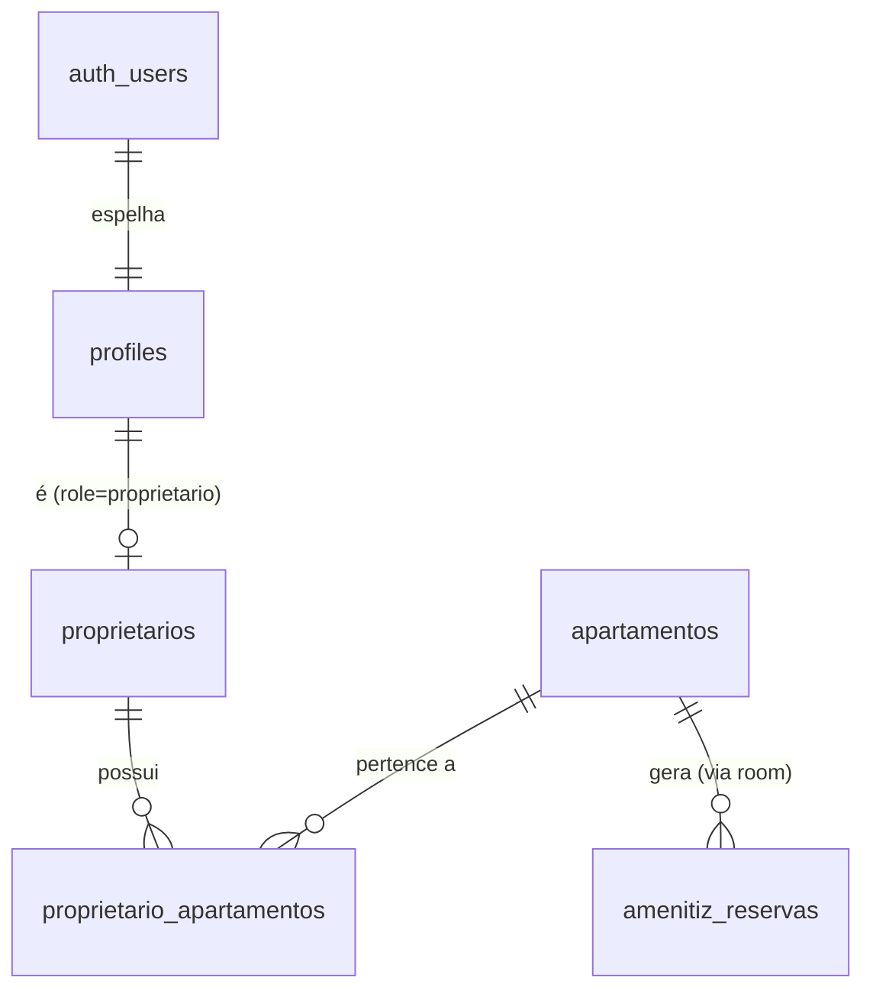
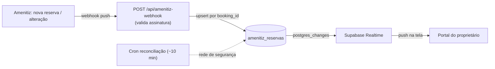

# 🔑 Portal do Proprietário — Plano Estratégico

> **Documento:** Plano de arquitetura e produto da nova camada externa do AlugEasy
> **Versão:** 1.0 · **Data:** 29/06/2026
> **Pré-requisito:** Sistema Financeiro AlugEasy (Next.js 16 + Supabase + Amenitiz)

---

## Sumário

1. [Objetivo da camada](#1-objetivo-da-camada)
2. [O que muda em relação ao sistema atual](#2-o-que-muda-em-relação-ao-sistema-atual)
3. [Camada de acesso — novo perfil `proprietario`](#3-camada-de-acesso--novo-perfil-proprietario)
4. [Estratégia de "tempo real"](#4-estratégia-de-tempo-real)
5. [Modelo de dados — o que mostrar e de onde vem](#5-modelo-de-dados--o-que-mostrar-e-de-onde-vem)
6. [Métricas de desempenho — fórmulas](#6-métricas-de-desempenho--fórmulas)
7. [Layout do painel — como apresentar](#7-layout-do-painel--como-apresentar)
8. [Privacidade e segurança (LGPD)](#8-privacidade-e-segurança-lgpd)
9. [Mudanças concretas — schema, rotas e componentes](#9-mudanças-concretas--schema-rotas-e-componentes)
10. [Roadmap por fases](#10-roadmap-por-fases)
11. [Decisões em aberto](#11-decisões-em-aberto)

---

## 1. Objetivo da camada

Transformar o AlugEasy de um sistema **100% interno** numa plataforma com uma **área externa autenticada**, onde cada proprietário entra e vê **apenas os imóveis dele**, com:

- **Reservas atualizadas ao vivo** (sincronizadas da Amenitiz sem ação manual).
- **Indicadores de desempenho** do imóvel (ocupação, diária média, faturamento, repasse).
- **Transparência financeira** — quanto ele vai receber, reaproveitando a lógica de prestação de contas que já existe.

O princípio que guia tudo: **o proprietário vê o resultado, nunca a operação interna da AlugEasy** (custos internos detalhados, dados de outros imóveis, taxas brutas de plataforma sem contexto).

---

## 2. O que muda em relação ao sistema atual

| Hoje | Com o Portal |
|---|---|
| Só `analista` e `admin` acessam | Novo perfil `proprietario` com escopo restrito |
| Toda tabela é visível para qualquer autenticado (SELECT livre) | RLS por vínculo proprietário → apartamento |
| Sync Amenitiz manual (botão em `/importar`) | Sync automático agendado + push em tempo real |
| Uma única área (`/`, sidebar interna) | Área separada `/portal` sem a sidebar interna |
| Dados pensados para a gestora | Dados traduzidos para o dono do imóvel |

> ⚠️ **Atenção ao bug conhecido dos roles invertidos** (`analista` = escrita, `admin` = leitura). Antes de criar `proprietario`, padronize a semântica de roles, senão a terceira camada herda a confusão.

---

## 3. Camada de acesso — novo perfil `proprietario`

### 3.1 Modelo de vínculo

Hoje `apartamentos.nome_proprietario` é apenas um **texto livre** — frágil para controle de acesso. A camada precisa de uma entidade real ligada ao `auth.users`.



- Um **proprietário** pode ter **vários apartamentos** (tabela de junção `proprietario_apartamentos`).
- Um **apartamento** pode pertencer a um proprietário (ou ser compartilhado, se o negócio exigir — a junção já cobre os dois casos).
- `profiles.role` ganha o valor `'proprietario'`, além de `'admin'` e `'analista'`.

### 3.2 Isolamento (RLS)

O ponto mais crítico da camada. O proprietário só pode dar `SELECT` em linhas dos imóveis dele:

```sql
-- Exemplo de policy em amenitiz_reservas
CREATE POLICY "proprietario_ve_suas_reservas" ON amenitiz_reservas
FOR SELECT USING (
  EXISTS (
    SELECT 1
    FROM apartamentos a
    JOIN proprietario_apartamentos pa ON pa.apartamento_id = a.id
    WHERE a.numero = amenitiz_reservas.individual_room_number  -- ver nota
      AND pa.proprietario_id = auth.uid()
  )
);
```

> **Nota técnica:** o vínculo `individual_room_number → apartamento` hoje é por número (texto). Para RLS confiável, vale promover `amenitiz_reservas.apartamento_id` a coluna real preenchida na sincronização (o sync já resolve esse mapeamento). Isso torna as policies mais simples e seguras.

Aplicar a mesma lógica em `custos`, `diarias` e `apartamentos`. Para **custos**, criar uma *view* filtrada que expõe só as categorias repassáveis ao proprietário — nunca os custos internos da gestora.

### 3.3 Separação de áreas

| Rota | Quem acessa |
|---|---|
| `/`, `/empreendimentos`, `/importar`, ... | `analista`, `admin` (interno) |
| `/portal`, `/portal/reservas`, `/portal/desempenho` | `proprietario` |

O `proxy.ts` (middleware) passa a redirecionar: proprietário tentando acessar área interna → `/portal`; analista/admin acessando `/portal` → opcional (pode permitir para "ver como proprietário").

---

## 4. Estratégia de "tempo real" (requisito central)

**Requisito do produto:** assim que uma reserva é criada/alterada, ela deve aparecer no portal — sem ação manual e sem esperar o próximo ciclo de sync.

A Amenitiz **oferece webhooks de reserva** (confirmado no dev hub: "Webhooks" + "Webhooks management API", e a própria recomendação deles é preferir webhook a polling para eventos de nova reserva). Portanto o tempo real é a **arquitetura principal**, não uma evolução futura. O desenho combina três peças:



### Peça 1 — Webhook da Amenitiz *(gatilho instantâneo — primário)*

```
Amenitiz (nova reserva / alteração) → POST /api/amenitiz-webhook → valida assinatura → upsert amenitiz_reservas
```
- Latência mínima: a reserva entra no banco no instante em que a Amenitiz a registra.
- **Obrigatório:** validar a assinatura do webhook (HMAC/secret) — endpoint público só processa eventos legítimos da Amenitiz.
- Endpoint **idempotente**: o mesmo `booking_id` recebido duas vezes não duplica (upsert).
- Registrar o `amenitiz_room_id`/número → resolver `apartamento_id` na hora.

### Peça 2 — Supabase Realtime *(o "ao vivo" na tela)*

```
amenitiz_reservas muda → Supabase Realtime (postgres_changes)
  → o portal recebe o evento → reserva nova entra na lista/KPIs sem reload
```
- É o que faz a reserva "aparecer sozinha" na tela do proprietário.
- Habilitar Realtime na tabela `amenitiz_reservas` e assinar no client component do portal. **O Realtime respeita o RLS** — o proprietário só recebe eventos das linhas que pode ver (testar isso, §8).

### Peça 3 — Cron de reconciliação *(rede de segurança)*

```
Vercel Cron (ou pg_cron / Edge Function) a cada ~10 min
  → reaproveita a lógica de amenitiz-sync sobre uma janela móvel
  → upsert por booking_id (pega qualquer webhook perdido)
```
- Webhooks podem falhar, atrasar ou ser descartados; o poll periódico garante consistência eventual.
- **Migração necessária:** hoje o sync é *destrutivo* (DELETE + INSERT das diárias). Para rodar com frequência, migrar para **sync incremental** por janela móvel (mês corrente + próximos ~60 dias), só `upsert` por `booking_id`. Nada de apagar e reinserir em massa.

### Ordem de construção

| Prioridade | Mecanismo | Resultado percebido |
|---|---|---|
| **Núcleo** | Webhook + Realtime | Reserva aparece no portal no instante em que a Amenitiz a registra |
| **Núcleo** | Cron de reconciliação | Garante que nada se perde se um webhook falhar |

> **Ressalva honesta (upstream, fora do nosso controle):** a Amenitiz é parceira "Preferred" (não "Preferred+") das OTAs, então reservas de **Booking/Airbnb** podem levar alguns minutos no salto OTA→Amenitiz antes de existir lá. Reservas **diretas** (motor da Amenitiz) são instantâneas. Entregamos instantâneo a partir da Amenitiz — o trecho OTA→Amenitiz não depende de nós.

Exibir sempre no portal o selo **"Atualizado há X min"** com o horário do último evento/sync. Tempo real honesto > promessa de instantâneo que falha.

---

## 5. Modelo de dados — o que mostrar e de onde vem

Mapa direto dos campos de `amenitiz_reservas` para o que o proprietário vê:

| O proprietário vê | Campo de origem | Observação |
|---|---|---|
| Reserva (linha) | `booking_id` | chave de deduplicação |
| Hóspede | `nome_hospede` | **mascarar** (ver §8) |
| Entrada / saída | `checkin` / `checkout` | base para nº de noites |
| Canal | `plataforma` | Booking / Airbnb / Direto |
| Valor da reserva | `valor_bruto` | receita antes da taxa de canal |
| Valor líquido | `valor_liquido` | após taxa de plataforma |
| Imóvel | `individual_room_number` → `apartamento_id` | promover a FK (ver §3.2) |
| Período | `mes_competencia` / `ano_competencia` | filtro do painel |
| Status | (do sync) | ignorar canceladas/no-show, já tratado |

**Dados que ainda não existem e são necessários para KPIs:**

- **Noites vendidas:** derivável de `checkout - checkin` (não precisa de campo novo).
- **Capacidade / dias disponíveis:** necessário para **Ocupação** e **RevPAR**. Definir como `dias_no_mês × nº_de_unidades_do_proprietário` (ou descontar bloqueios, se a Amenitiz expuser disponibilidade). Decisão de negócio — ver §11.

---

## 6. Métricas de desempenho — fórmulas

Defina cada KPI com fórmula e fonte para que o número seja auditável.

| KPI | Fórmula | Fonte |
|---|---|---|
| **Faturamento bruto** | Σ `valor_bruto` no período | `amenitiz_reservas` |
| **Faturamento líquido** | Σ `valor_liquido` no período | `amenitiz_reservas` |
| **Noites vendidas** | Σ (`checkout` − `checkin`) | derivado |
| **Diária média (ADR)** | Faturamento bruto ÷ Noites vendidas | derivado |
| **Ocupação (%)** | Noites vendidas ÷ Noites disponíveis × 100 | derivado + capacidade |
| **RevPAR** | Faturamento bruto ÷ Noites disponíveis | derivado + capacidade |
| **Ticket médio / reserva** | Faturamento ÷ nº de reservas | `amenitiz_reservas` |
| **Mix de canais** | % de reservas por `plataforma` | `amenitiz_reservas` |
| **Repasse ao proprietário** | reaproveitar cálculo da prestação de contas | `apartamentos.taxa_repasse` + `tipo_repasse` |

> **Reaproveite o que existe:** a fórmula de repasse (Receita − Custos − Taxa AlugEasy = Líquido ao proprietário) já está implementada na prestação de contas. O portal deve consumir a **mesma** função para não divergir do PDF que o proprietário recebe.

Toda métrica deve trazer **comparativo** (vs. mês anterior ou vs. mesmo mês do ano passado) — é o que dá sensação de "desempenho", não só de "número".

---

## 7. Layout do painel — como apresentar

Princípio de UX: **resultado primeiro, detalhe sob demanda.** O proprietário não é operador — ele quer responder em 5 segundos "meu imóvel está indo bem?".

```
┌─────────────────────────────────────────────────────────────┐
│  [Imóvel ▾]   [Período ▾]            🟢 Atualizado há 3 min   │  ← header
├─────────────────────────────────────────────────────────────┤
│  ┌──────────┐ ┌──────────┐ ┌──────────┐ ┌──────────┐          │
│  │ Repasse  │ │ Ocupação │ │   ADR    │ │  RevPAR  │          │  ← faixa de KPIs
│  │ R$ 8.420 │ │   78%    │ │  R$ 312  │ │  R$ 243  │          │     (com ▲▼ vs mês ant.)
│  │  ▲ 12%   │ │  ▲ 5pp   │ │  ▼ 2%    │ │  ▲ 8%    │          │
│  └──────────┘ └──────────┘ └──────────┘ └──────────┘          │
├──────────────────────────────────┬──────────────────────────┤
│  Tendência (6 meses)             │  Mix de canais            │  ← gráficos
│  [linha: faturamento/ocupação]   │  [donut: Booking/Airbnb]  │     (Recharts)
├──────────────────────────────────┴──────────────────────────┤
│  Calendário de ocupação — heatmap do mês                     │  ← visual de ocupação
├─────────────────────────────────────────────────────────────┤
│  Reservas ao vivo                          [🟢 tempo real]    │
│  ┌─────────────────────────────────────────────────────────┐ │
│  │ Apt 101 · J. S.*** · 12–15 jun · Booking · R$ 936       │ │  ← tabela de reservas
│  │ Apt 101 · M. R.*** · 18–20 jun · Direto  · R$ 624 (novo)│ │
│  └─────────────────────────────────────────────────────────┘ │
├─────────────────────────────────────────────────────────────┤
│  Próximos check-ins / check-outs   │   [⬇ Baixar prestação]   │  ← ações
└─────────────────────────────────────────────────────────────┘
```

**Componentes a construir (reaproveitando shadcn/ui + Recharts já no projeto):**

1. **Seletor de imóvel** — só aparece se o proprietário tiver mais de um.
2. **Faixa de KPIs** — cards com valor + variação (▲/▼) colorida.
3. **Gráfico de tendência** — `LineChart` (reusa o padrão de `relatorio/charts.tsx`).
4. **Mix de canais** — `PieChart`/donut por plataforma.
5. **Calendário de ocupação** — heatmap mensal (dias ocupados destacados).
6. **Tabela de reservas ao vivo** — assina Supabase Realtime; reserva recém-chegada entra com destaque "novo".
7. **Próximos eventos** — lista de check-ins/check-outs dos próximos 7 dias.
8. **Botão de prestação de contas** — chama o `GET /api/prestacao-contas-pdf` existente.

---

## 8. Privacidade e segurança (LGPD)

| Risco | Mitigação |
|---|---|
| Proprietário ver imóvel de outro | RLS por vínculo (§3.2) — testar com 2+ proprietários |
| Vazar custos internos da gestora | View filtrada de custos; nunca expor categorias internas |
| Dados pessoais do hóspede | **Mascarar** `nome_hospede` (ex.: "J. S.\*\*\*"); não expor e-mail/telefone/documento |
| Service role key no front | Toda escrita/sync roda server-side; portal é read-only |
| Abuso de endpoint | Rate limiting nas rotas do portal; sync só por cron/server |
| Eventos Realtime vazando linhas | Realtime respeita RLS — confirmar policies antes de habilitar |

O portal do proprietário é, por padrão, **somente leitura**. Ele consome dados; não escreve nada no banco operacional.

---

## 9. Mudanças concretas — schema, rotas e componentes

### Migrations novas

```
007_portal_proprietario.sql
  - ALTER profiles: aceitar role 'proprietario'
  - CREATE TABLE proprietarios (id, profile_id, nome, email, ...)
  - CREATE TABLE proprietario_apartamentos (proprietario_id, apartamento_id)
  - ALTER amenitiz_reservas: ADD COLUMN apartamento_id uuid (FK) — promover mapeamento
  - Backfill de apartamento_id nas reservas existentes

008_portal_rls.sql
  - Policies de SELECT por vínculo em: amenitiz_reservas, custos (view), diarias, apartamentos
  - Habilitar Realtime em amenitiz_reservas

009_sync_incremental.sql / ajuste no código
  - Tornar o sync idempotente por janela móvel (sem DELETE em massa)
```

### Rotas novas

| Rota | Tipo | Acesso | Função |
|---|---|---|---|
| `/portal` | Página | `proprietario` | Dashboard de desempenho |
| `/portal/reservas` | Página | `proprietario` | Lista completa de reservas ao vivo |
| `/portal/desempenho` | Página | `proprietario` | Histórico e tendências |
| `POST /api/amenitiz-webhook` | API | Amenitiz (assinatura HMAC) | **Núcleo** — push instantâneo de reservas |
| `POST /api/amenitiz-sync-cron` | API | Cron (secret) | Reconciliação periódica (rede de segurança) |

### Componentes novos

- `app/portal/layout.tsx` — layout próprio (sem sidebar interna).
- `components/portal/kpi-strip.tsx`, `occupancy-heatmap.tsx`, `live-reservations-table.tsx`, `channel-mix-chart.tsx`.
- Hook `useRealtimeReservas(apartamentoIds)` — assina `postgres_changes`.

---

## 10. Roadmap por fases

| Fase | Entrega | Dependências |
|---|---|---|
| **1 — Fundação de acesso** | Role `proprietario`, tabelas de vínculo, RLS, `amenitiz_reservas.apartamento_id` (FK), layout `/portal` read-only com KPIs do último sync | Padronizar roles antes |
| **2 — Tempo real (núcleo)** | Webhook `/api/amenitiz-webhook` (assinado, idempotente) + Supabase Realtime + tabela de reservas ao vivo + cron de reconciliação + sync incremental | RLS testado · secret do webhook |
| **3 — Métricas de desempenho** | Ocupação, ADR, RevPAR, calendário, comparativos | Definir capacidade |
| **4 — Evolução** | Notificações (e-mail/push "nova reserva"), prestação de contas self-service, multi-imóvel avançado | — |

A Fase 1 já entrega um painel real ao proprietário (mesmo sem "ao vivo"); o **tempo real entra logo na Fase 2**, que é o requisito central do produto.

---

## 11. Decisões em aberto

1. **Webhooks da Amenitiz — ✅ confirmado.** A Amenitiz oferece webhooks de reserva e uma API de gestão de webhooks. Tempo real é o núcleo (Fase 2). Resta obter o **secret de assinatura** e o **formato do payload** do evento de reserva no painel/conta de desenvolvedor da Amenitiz, e cadastrar a URL do nosso endpoint. *(Ressalva: reservas de OTA dependem do salto OTA→Amenitiz, fora do nosso controle — ver §4.)*
2. **Como medir capacidade para Ocupação/RevPAR?** Dias do mês × unidades, ou descontando bloqueios/manutenção? Sem isso, Ocupação e RevPAR não têm denominador confiável.
3. **Repasse no portal: mostrar valor exato ou estimativa do mês corrente?** O mês ainda não fechou — sugiro rótulo "estimativa parcial" até o fechamento.
4. **Um proprietário pode ter imóveis em vários empreendimentos?** A tabela de junção já cobre, mas confirma o seletor de imóvel.
5. **Login do proprietário:** convite por e-mail (analista cadastra e envia) ou auto-cadastro? Recomendo **convite controlado** — a gestora decide quem entra.

---

> **Próximo passo sugerido:** obter o secret/payload do webhook da Amenitiz (§11.1) e validar os pontos 2 a 5. Com isso travado, Fase 1 (acesso + RLS + layout) e Fase 2 (tempo real) podem ser implementadas em sequência.
